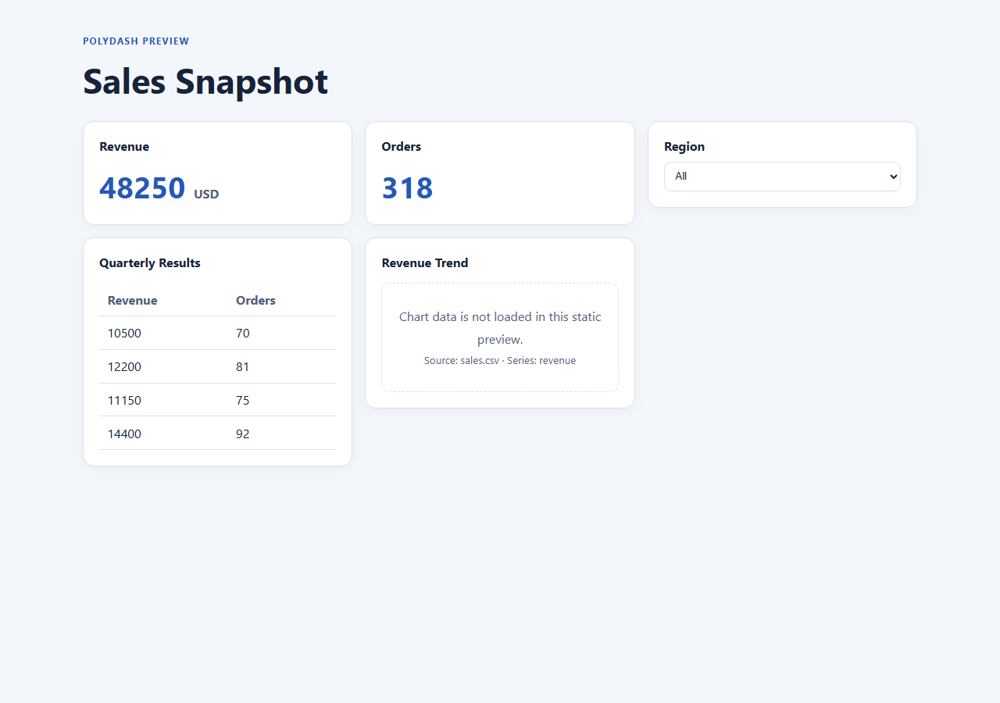

# PolyDash — Multi-Format Dashboard Compiler

PolyDash validates dashboard configurations before code generation, with errors
that point back to the source file. It builds on the Config2UI lab project idea;
the earlier prototype is not included in this repository.

## Current status

Implemented in this increment (issues #6–#11):

- JSON parsing with source positions and a documented grammar.
- Shared Dashboard IR and a small, data-driven component schema.
- Required-field, unknown-component/property, property-type and duplicate-ID
  validation, collecting all recoverable errors.
- Human and structured JSON diagnostics, a golden regression corpus and
  JSON/YAML equivalence tests.
- Optional YAML/YML front end: install the declared `yaml` extra (PyYAML).
  See [YAML support](docs/yaml-support.md) for the subset and installation.

An initial static HTML preview can render validated metric, table, filter, and
group components. Charts show a labeled placeholder because data source strings
are not fetched. Live data access, chart plotting, JavaScript interactions, and
a full compile CLI are still planned. The CI workflow targets Windows, Linux
and macOS. The new schema/IR
and diagnostic contracts are initial baselines for architecture-owner review;
the prerequisite architecture issues #2/#3 have not been marked approved.
The [proposed architecture baseline](docs/architecture.md),
[decision records](docs/adr/0001-language-runtime.md),
[shared JSON/IR contract](docs/contracts/ir-json-shared-contract.md) and
[backlog audit](docs/backlog-audit.md) document open decisions. A
[comparison survey](docs/research/dashboard-generator-survey.md) records
prior art; source-aware validation is a project goal, not a novelty claim.

## Local setup and checks

Python 3.10+ is required. Run commands from the repository root; JSON checking
needs no third-party libraries and no install step:

```sh
python -m polydash tests/fixtures/pairs/valid-minimal.json
python -m polydash tests/fixtures/golden/multiple.json --diagnostics-json diagnostics.json
python -m polydash examples/demo.json --output dashboard.html
```

Human diagnostics go to stderr; `--diagnostics-json` also writes a JSON artifact.
`--output` writes one self-contained HTML file only when validation succeeds.
Open `dashboard.html` in a browser to show the prototype. The demo's table rows
are illustrative values stored directly in the configuration; the filter is a
native control and does not change other components.


Exit status is 0 for success, 1 for invalid input, and 2 for usage/I/O errors or
an unavailable YAML library. Invalid input never exposes downstream IR.

Install the optional YAML dependency before running the full suite:

```sh
python -m pip install ".[yaml]"
python -m unittest discover -v
```

Tests cover 36 golden configurations, 29 malformed-input fixtures, seven
JSON/YAML pairs, source locations, schema extensibility and CLI behavior. No
external services are required by these tests. A GitHub Actions matrix runs the
suite on Windows/Linux/macOS with Python 3.10 and 3.12 (issue #12). See
[clean development setup](docs/dev-setup.md).

Regenerate goldens only for intentional diagnostic changes:

```sh
python -m tests.update_goldens
git diff -- tests/fixtures/golden
python -m unittest discover -v
```

Review every changed expected diagnostic before committing.

## Configuration example

```json
{
  "title": "Sales",
  "layout": {"direction": "column"},
  "components": [
    {"id": "revenue", "type": "metric", "value": 42, "unit": "USD"},
    {
      "id": "trend",
      "type": "chart",
      "data": {"source": "sales.csv"},
      "series": ["revenue"],
      "kind": "line",
      "stacked": false
    }
  ]
}
```

Supported component types: metric, chart, table, filter and nested group.
Data sources are opaque strings; they are not fetched or executed.
JSON and YAML produce the same configuration shape and source-location map.
The shared analyzer validates that candidate before it is exposed as IR.

The [accessibility/responsive research spike](docs/research/a11y-responsive-spike.md)
proposes bounded authoring checks and records what requires generated output or
browser testing. PD2001/PD2002 now implement the bounded title warnings; broader accessibility
and responsive checks remain proposals. The
[issue review](docs/issue-review.md) records evidence and remaining criteria for
all fourteen original issues.

## Contracts and tests

- [Shared IR and component schema](docs/ir.md)
- [JSON grammar, parse/semantic boundary and fixture inventory](docs/json-grammar.md)
- [Validation rules, diagnostics and golden regeneration](docs/validation-rules.md)
- [YAML subset and optional dependency](docs/yaml-support.md)
- [Cross-format equivalence and adding paired fixtures](docs/equivalence-tests.md)

The v1 scope excludes expressions, variables, custom components, includes,
YAML aliases/anchors and multi-document streams. TOML and a Markdown DSL remain
possible future front ends. Missing/blank filter and chart titles produce accessibility authoring warnings
(PD2001/PD2002); warnings preserve IR and exit status 0. They do not establish
WCAG conformance. Responsive-layout checks remain research topics.

## Contributing

See [CONTRIBUTING.md](CONTRIBUTING.md) for the branch/PR workflow, required tests
and teammate review. The [documentation index](docs/README.md) distinguishes
implementation contracts from pending architecture proposals.

Use feature branches and pull requests; do not push directly to main. Describe
the behavior, linked issues and validation in each PR. Architecture contracts and
new dependencies require owner review before merge. Compiler changes need
positive/negative fixtures; cross-format changes need paired fixtures. The goal
is consistent behavior on Windows, Linux and macOS; the test matrix verifies
these platforms on each PR and push.

| Member | Focus |
| --- | --- |
| [Bhavye Kathuria](https://github.com/thebhavye) | Architecture and integration |
| Ayush Kumar Verma | Implementation and validation; GitHub account pending verification |
